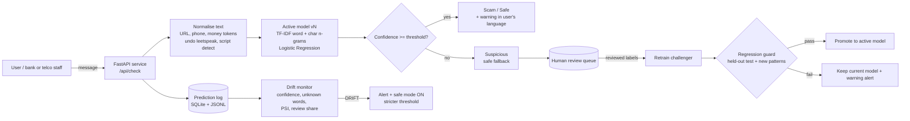

# TrapWire LK

**Multilingual scam detection for Sri Lanka that notices when scammers change tactics.**

TensorForge 2.0 Final-Forge · Theme: *Scam-Proof by Design* · Team Data Pulse

> TrapWire LK detects multilingual (Sinhala, Tamil, English and Singlish) impersonation scams targeting vulnerable communities in Sri Lanka, such as elderly people, welfare recipients and first-time mobile-banking users, and monitors changing scam patterns to flag uncertain messages for human review and trigger controlled model updates.

---

## 1. Problem and users

Scam SMS and WhatsApp messages in Sri Lanka impersonate banks, the Aswesuma welfare programme, pension offices, couriers and lotteries. They are written in Sinhala, Tamil, English and mixed Singlish/Tanglish, and they change wording quickly. A detector that is accurate on launch day can fail weeks later without anyone noticing.

**Who we protect**

| User group | Why they are targeted |
|---|---|
| Elderly people and pensioners | 18% of Sri Lankans are 60+ (2024 census); pension and bank messages create urgency |
| Aswesuma welfare recipients | About 1.66 million families received payments in January 2026; fake "pending payment" and "registration fee" messages target them |
| First-time mobile-banking users | Unfamiliar with OTP and PIN safety |

**Who uses TrapWire:** the person who received the message (paste and check), and bank, telco or community-centre staff who handle "is this real?" questions and review uncertain cases.

## 2. What it does

1. **Detect.** Paste a message and get a verdict (**Scam / Suspicious / Safe**), the scam type, a confidence score, key words behind the decision and a warning in the sender's language.
2. **Monitor.** Every prediction is logged. A rolling window is compared with the model's reference profile using four drift signals.
3. **Respond.** When drift is detected TrapWire raises an alert, switches on **safe mode** (stricter threshold, so uncertain messages become "Suspicious, verify first" instead of a silent wrong answer), and routes those messages to a **human-review queue**.
4. **Adapt, with control.** Reviewed labels trigger retraining of a **challenger model**. It is promoted only if it does not regress on the held-out test set and it improves on the new patterns.

## 3. Architecture



| Component | File |
|---|---|
| Data generator (train / test / shifted) | `scripts/generate_data.py` |
| Text normalisation and language detection | `src/textprep.py` |
| Model, evaluation, drift reference profile | `src/model.py` |
| Training and evaluation report | `scripts/train.py` → `reports/evaluation.json` |
| API, safe mode, retraining with regression guard | `app/main.py` |
| Drift signals | `app/monitor.py` |
| Prediction log, review queue, alerts | `app/store.py` |
| Web app (check, monitoring dashboard, review, model registry) | `app/static/index.html` |
| Tests | `tests/test_api.py` |

## 4. How to run

**Option A: Docker (recommended).** The image generates the data and trains the model at build time.

```bash
docker build -t trapwire-lk .
docker run -p 8000:8000 trapwire-lk
```

**Option B: Python 3.12+**

```bash
python -m venv .venv
# Windows: .venv\Scripts\activate    Linux/macOS: source .venv/bin/activate
pip install -r requirements.txt
python scripts/generate_data.py
python scripts/train.py
uvicorn app.main:app --port 8000
```

Or run `run.bat` (Windows) / `run.sh` (Linux/macOS). Open **http://localhost:8000**.

**Tests:** `python -m pytest -q`

### API

| Method | Path | Purpose |
|---|---|---|
| GET | `/health` | Liveness and active model version |
| POST | `/api/check` | `{"text": "..."}` → verdict, scam type, confidence, warning, key words |
| GET | `/api/monitor` | Drift status, signals, timeline, alerts, review counts |
| GET / POST | `/api/review` | Pending review queue / submit a label |
| POST | `/api/retrain` | Train a challenger and promote it only if it passes the guard |
| GET | `/api/models` | Model registry |
| POST | `/api/demo/replay` | Stream `test` or `shifted` messages through the service |
| POST | `/api/demo/auto_review` | Simulated reviewer for the demo (labels from the synthetic ground truth) |
| POST | `/api/demo/reset` | Reset logs and return to model v1 |

## 5. Data

No dataset was provided, so all data was **generated during the build window** by `scripts/generate_data.py` (seed 42, fully reproducible). The generated CSV files are **not committed** to this public repository (Rule 2.6: synthetic scam messages are never posted publicly); run the script to recreate them locally, or build the Docker image, which does it automatically.

| Set | Rows | Contents |
|---|---|---|
| `data/train.csv` | 3,808 | 6 classes (bank impersonation, welfare, pension, parcel, lottery, legit) in English, Sinhala, Tamil, Singlish and Tanglish: 2,368 template messages + 1,440 compositional augmentations |
| `data/test.csv` | 1,192 | **Held-out test set.** Half the messages use wording templates that never appear in training, so the score measures generalisation, not memorisation |
| `data/shifted.csv` | 1,022 | **Drift set.** A new impersonation target (fake **SL-UDI digital ID** messages), heavier Singlish/Tanglish mixing, and old scams obfuscated with leetspeak, emoji and spaced letters |

**Sources and licences**

| Source | Method | Licence |
|---|---|---|
| Scam and legitimate message templates | Hand-written by the team in English, Sinhala, Tamil, Singlish and Tanglish, based on public scam-awareness descriptions | Original work, released with this repo (MIT) |
| Slot values (amounts, fees, links, masked phone numbers) | Randomly generated | Synthetic |

**Privacy (PDPA No. 9 of 2022):** no real personal data. Bank names are fictional (Lanka Trust Bank, Ceylon Union Bank, Island Savings Bank), links use the reserved `.example` domain, and phone numbers are masked (`07X-xxx-1234`). The synthetic scam messages are for training and testing only and must never be sent to real people.

## 6. Evaluation results (held-out test set, model v1)

| Metric | Naive Bayes baseline | TrapWire v1 |
|---|---|---|
| **Scam recall** (scams caught) | 100% | **100%** |
| **Scam precision** (flagged messages that are scams) | 100% | **100%** |
| False alarms on legitimate messages | 0 | **0** |
| Scam-type accuracy (6 classes) | 87.4% | **89.5%** |
| Scam-type macro-F1 | 0.866 | **0.892** |

**Honest breakdown by wording**

| Test subset | Messages | Scam-type accuracy | Scam recall |
|---|---|---|---|
| Wording seen in training | 592 | 100% | 100% |
| Wording **never seen** in training | 600 | 79.2% | 100% |

**By language (scam-type accuracy):** English 92.4%, Sinhala 82.2%, Tamil 80.8%, Singlish 100%, Tanglish 100%.

**Model iterations**

| Iteration | Change | Type accuracy | Unseen-wording accuracy |
|---|---|---|---|
| 1 | TF-IDF word + char n-grams, logistic regression, template data only | 74.8% | 50.0% |
| 2 | + compositional augmentation (opener + claim + action + deadline in 4 languages), training set only | **89.5%** | **79.2%** |

The test and shifted sets are identical across iterations (generated from a separate random stream), so the gain is real generalisation, not a change in the test.

What this shows: TrapWire separates scams from legitimate messages reliably, but it still names the wrong scam *type* for about one in five messages with new wording, and real messages will be harder than synthetic ones. That is why the product monitors itself and keeps humans in the loop instead of trusting launch-day accuracy. Full per-class results and the confusion matrix are in `reports/evaluation.json`.

**Before drift response vs after (shifted set)**

| | Model v1 (before) | Model v2 (after review + retraining) |
|---|---|---|
| Mean confidence on shifted traffic | 0.71 (reference 0.87) | ~0.92 |
| Accuracy on shifted messages not used for retraining | ~51% | ~89% |
| Held-out test macro-F1 (regression guard) | 0.892 | ~0.93 (no regression) |

v2 numbers come from the live demo loop (`/api/retrain` output, also checked in `tests/test_api.py`); exact values vary slightly with the replay sample.

## 7. Monitoring and drift response

**Signals** (rolling window of the last 60 predictions of the *active* model, judged once 25 exist):

| Signal | Reference | Warning | Drift |
|---|---|---|---|
| Average confidence | Mean confidence on the held-out test set | drop ≥ 0.06 | drop ≥ 0.10 |
| Share of unknown words | Unknown-word share on the held-out test set | rise ≥ 0.08 | rise ≥ 0.15 |
| PSI of the confidence distribution | Test-set histogram | ≥ 0.10 | ≥ 0.25 (only while confidence is falling) |
| Share sent to human review | — | — | ≥ 35% |

Status is **DRIFT** when two or more signals are at drift level, **WARNING** when any signal is raised.

**Response**

1. **Alert:** a CRITICAL alert is logged and shown on the dashboard, naming the signals that fired.
2. **Safe fallback:** safe mode raises the review threshold from 0.60 to 0.75, so uncertain messages are shown as *"Suspicious: verify with the official number"* rather than a confident wrong answer.
3. **Human review:** every Suspicious message enters the review queue.
4. **Controlled retraining:** after 30 reviewed labels, a challenger model is trained on the training data plus reviewed messages. It is promoted only if held-out test macro-F1 drops by no more than 0.02 **and** accuracy on unseen shifted messages improves. Otherwise it is rejected and the current model stays active. Every decision is logged in the alerts and the model registry.

**Drift demo (in the web app, Monitoring tab):** ① normal traffic → all signals normal · ② SL-UDI scam wave → DRIFT, alert, safe mode · ③ review queue labelled · ④ retrain → v2 promoted · ② again → signals return to normal.

**Logging:** each prediction is written to `logs/trapwire.db` (SQLite) and `logs/predictions.jsonl` with time, text, language, prediction, confidence, verdict, unknown-word share and model version. Service logs go to stdout.

## 8. Impact

See [IMPACT.md](IMPACT.md).

## 9. Limitations

- All data is synthetic. Real scam messages are more varied, so real-world accuracy will differ until the model is trained on labelled reports from a partner (for example a bank fraud desk or the CBSL/CERT reporting channel).
- In the demo, "human review" is simulated with the synthetic ground truth; in production it would be trained bank or telco staff.
- Scam-type accuracy on unseen wording is 79%; Sinhala and Tamil type accuracy (81–82%) is lower than English and Singlish.

## 10. AI tools used

- **Claude (Anthropic)** was used as a coding assistant to help write the data generator, model, API, monitoring, web app, tests and this README. Every team member reviewed the code and can explain it.
- No LLM is called at runtime; the core detector is a model we trained.

## 11. Licence

MIT. See [LICENSE](LICENSE).
